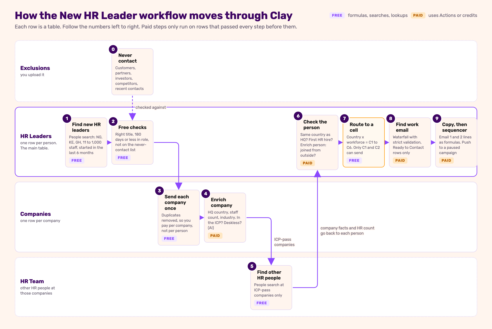

# Clay Build Guide: New HR Leader, First 6 Months (PaidHR)

A step-by-step guide to building `workflow-spec.md` (in this folder) in Clay. Written for someone who has never built anything in Clay. Follow the parts in order. Each step tells you **why** it exists, **what to click**, **what to type**, **how to check it worked** and **what it costs**.

> **Don't skip the checks.** The most common Clay mistake is running a column on 500 rows before checking it worked on 1. Every step below ends with a check. If the check fails, fix it before moving on.

> **Built from:** `workflow-spec.md` as revised 2026-11-12 (180-day window, 10 to 1,000 employees, global HRIS gate removed) and its approved copy (Emails 1 to 3, approved 2026-11-07 and 2026-11-11). Nothing in this guide makes the campaign sendable: the spec's own blockers still apply (see [Part 12](#part-12-connect-the-sequencer)).

---

## Contents

- [What you are building](#what-you-are-building)
- [Clay words you need](#clay-words-you-need)
- [Before you start](#before-you-start)
- [Part 0. Set up the workbook](#part-0-set-up-the-workbook)
- [Part 1. Exclusions table](#part-1-exclusions-table)
- [Part 2. Find the new HR leaders](#part-2-find-the-new-hr-leaders)
- [Part 3. Free gates on each person](#part-3-free-gates-on-each-person)
- [Part 4. Companies table](#part-4-companies-table)
- [Part 5. HR Team table](#part-5-hr-team-table)
- [Part 6. Bring company facts back to each person](#part-6-bring-company-facts-back-to-each-person)
- [Part 7. Check the person](#part-7-check-the-person)
- [Part 8. Route each person to a cell](#part-8-route-each-person-to-a-cell)
- [Part 9. Find and verify the work email](#part-9-find-and-verify-the-work-email)
- [Part 10. Write the email lines](#part-10-write-the-email-lines)
- [Part 11. Views for the operator](#part-11-views-for-the-operator)
- [Part 12. Connect the sequencer (build it, don't run it)](#part-12-connect-the-sequencer)
- [What it costs](#what-it-costs)
- [Final checklist](#final-checklist)
- [When something goes wrong](#when-something-goes-wrong)
- [Things the spec needs to fix](#things-the-spec-needs-to-fix)

---

## What you are building

The spec says: find HR or People leaders in Nigeria, Kenya or Ghana who **joined their company from another company in the last 180 days**, at companies with 10 to 1,000 employees. Check that the company and the person fit, and sort each person into one of 6 "cells" (country x type of workforce). Find their work email, and write a 3-email sequence for the two Nigerian cells (C1, C2). Kenya and Ghana rows are built and kept, but never sent.

You will build **4 tables** inside **1 workbook**:



Each row of the picture is a table. The numbers are the order you build in. Step 0 is the list you upload first.

| Diagram step | Part of this guide |
|---|---|
| 0 Never contact | Part 1 |
| 1 Find new HR leaders | Part 2 |
| 2 Free checks | Part 3 |
| 3 Send each company once | Part 4.1 to 4.2 |
| 4 Enrich company | Part 4.3 to 4.6 |
| 5 Find other HR people | Part 5 |
| 6 Check the person | Parts 6 and 7 |
| 7 Route to a cell | Part 8 |
| 8 Find work email | Part 9 |
| 9 Copy, then sequencer | Parts 10, 11 and 12 |

Why this shape:
- **People first**, because the trigger is something that happened to a person (they started a new job). Clay's people search finds them for free.
- **Company checks happen once per company** in their own table. If 3 people at one company show up, you pay to enrich that company once, not three times.
- **Everything paid runs last**, and only on rows that passed every free check before it. Company checks (HQ country, size, industry) run **before** you pay for anything about the person, so you never enrich a person or find an email at a company that can't be sent to.

What a finished row in **HR Leaders** looks like, reading left to right (made-up example):

| Person | Title | Company | Started | Days | Country | Workforce | First HR hire? | Joined from | Cell | Ready? | Email | E1 L1 … E2 L3 |
|---|---|---|---|---|---|---|---|---|---|---|---|---|
| Ada O. | Head of People | Acme Logistics | 2026-08 | 105 | NG | deskless | No | Kobo360 | C1 | Yes | ada@acme… | You joined the HR team at Acme… |

---

## Clay words you need

| Word | What it means |
|---|---|
| **Workbook** | A folder of tables for one campaign. |
| **Table** | A spreadsheet. One row per company or per person. |
| **Source** | Where a table's rows come from (a Clay search, a CSV, another table). |
| **Column** | One piece of information per row. Three kinds matter: **plain** (you type or import it), **formula** (Clay calculates it, free), **enrichment / action** (Clay calls a data provider or AI, usually costs). |
| **Formula** | A small calculation, like a spreadsheet formula. Free. Clay has an AI helper: describe what you want in plain English and it writes the formula for you. |
| **Enrichment** | A column that looks something up (company size, a person's past jobs, an email). Costs **Actions**, and sometimes **Data Credits**. |
| **Use AI** | A column that asks an AI model a question about each row and returns an answer. Costs Actions plus a small AI cost. |
| **Claygent** | An AI column that browses websites to answer. Costs more than Use AI. Used here only as a fallback. |
| **Lookup** | A column that reads a matching row (or rows) from another table in your workbook. Free. |
| **Send table data** | A column that copies rows from this table into another table. Free. |
| **Run condition** ("Only run if") | A rule on a paid column: it only runs on rows where the rule is true. This is how you avoid paying for rows you'll throw away. |
| **Auto-run** | When on, new columns run on every row by themselves. **Keep it off** while building. |
| **Deduplicate** | A table setting that keeps only one row per value of a column (for example, one row per company domain). |
| **Waterfall** | An email finder that tries several providers in order and stops at the first one that finds a valid email. |
| **Actions** | Clay's main usage meter. About 1 Action per enrichment per row. Unused Actions expire monthly. |
| **Data Credits** | A second meter, used when Clay pays a data provider for you (for example, email finders). |
| **View** | A saved filter on a table, like "only rows ready to send". |
| **Spintax** | Text like `{Best,|Thanks,}`. The sequencer picks one option per email. |

---

## Before you start

Tick these off **before** you build. None of them should be done live.

- [ ] **Clay account** with access to the workspace you'll build in. Note which plan it's on (Settings → Plans & billing). You need enough Actions for roughly: number of companies x 2 + number of people x 2 + email lookups. See [What it costs](#what-it-costs).
- [ ] **Email finder connections** (Settings → Connections), if you'll use your own provider keys. Without your own keys, Clay uses its own and charges Data Credits.
- [ ] **The spec is open** next to you: `output/campaigns/new-hr-leader-180-days/workflow-spec.md`. Sections 2 (who's in and out), 4 (signals), 5 (cells), 6 (variables) and Copy are what you're building.
- [ ] **The Exclusions CSV** is ready, with every Domain filled in (Part 1 shows exactly what goes in it).
- [ ] **Test size decided.** This guide uses **25 people** for the first import. You can import more later.
- [ ] **A sequencer account** (Smartlead, Instantly or Clay's own) if you'll build Part 12. The campaign stays paused.

---

## Part 0. Set up the workbook

**Why:** one place for everything in this campaign, so anyone can find it and follow it.

1. In Clay, click **+ New** (top left) → **Workbook**.
2. Name it: `PaidHR · New HR Leader (180 days)`.
3. In the workbook description, paste: *"Signal: HR/People leaders in NG, KE, GH who joined from another company in the last 180 days, at companies with 10 to 1,000 employees. Spec: paidhr-gtm-os/output/campaigns/new-hr-leader-180-days/workflow-spec.md. Only cells C1 and C2 can send; C3 to C6 are held."*

**Check:** the workbook appears in your Clay home with that name.
**Cost:** free.

---

## Part 1. Exclusions table

**Why:** the spec (section 2, Exclude) lists companies we must never email: PaidHR's customers, partners, investors and competitors, plus anyone contacted in the last 90 days. We put them in one table so every other table can check against it.

### 1.1 Make the CSV

Create a spreadsheet with **3 columns** and save it as `exclusions.csv`. These 37 rows come straight from the spec:

| Company Name | Domain | Type |
|---|---|---|
| Famasi | | Customer |
| Heroshe | | Customer |
| Transport Services Limited | | Customer |
| Oando | | Customer |
| Flutterwave | | Customer |
| Risevest | | Customer |
| MAX | | Customer |
| Dantata | | Customer |
| Bamboo | | Customer |
| Busha | | Customer |
| Nikky Taurus | | Customer |
| FairMoney MFB | | Partner or investor |
| YALO | | Partner or investor |
| FUNDiT | | Partner or investor |
| Sync Capital | | Partner or investor |
| Yield MFB | | Partner or investor |
| Raenest | | Partner or investor |
| RemoFirst | | Partner or investor |
| Zitra | | Partner or investor |
| LSETF | | Partner or investor |
| Accion | | Partner or investor |
| SeamlessHR | | Competitor |
| Workpay | | Competitor |
| Soft Alliance (SoftSUITE) | | Competitor |
| SystemSpecs (HumanManager) | | Competitor |
| Bujeti | | Competitor |
| Salario | | Competitor |
| Paypaxe | | Competitor |
| Xceed365HR | | Competitor |
| Deel | | Competitor |
| Remote | | Competitor |
| Oyster | | Competitor |
| Cadana | | Competitor |
| Bento Africa | | Competitor |
| Pluspeople Kenya (Payroll.ke) | | Competitor |
| FaidiHR | | Competitor |
| PayRollGH | | Competitor |

**The Domain column is left blank on purpose.** This guide doesn't guess domains. Fill in every one before uploading:
- Find each company's own website on its LinkedIn company page (the "Website" link) or by searching its name.
- Type it plain, the way Clay shows domains: `example.com`. No `https://`, no `www.`, no slash at the end.
- Check it's the company's own site, not a product page or a country subdomain.
- If one company has two domains (for example a `.com` and a `.com.ng`), add a second row with the same name and type.

> **Why domain and not name:** names clash. "Bamboo", "MAX" and "Remote" are also names of unrelated companies, and the same company can appear as "Oando", "Oando PLC" or "Oando Energy". A domain belongs to one company.

> **Two lists still to come (spec "Open items" 1):** PaidHR's full customer list and its CRM list of companies contacted in the last 90 days or in active pipeline. When they arrive, add them to this same CSV with Type `Customer` or `Recently contacted`, and re-upload. After each send, add the contacted companies here as `Recently contacted` too: the spec suppresses a company for 90 days after contact (section 7).

### 1.2 Upload it

1. Inside the workbook, click **+ Add table** → **Import CSV**.
2. Upload `exclusions.csv`. Name the table `Exclusions`.
3. Change the `Domain` column's type to **URL** (column header → Edit column → Data type).

**Check:** 37 rows (or more, if you added second domains), 3 columns, no blank Domain cells.
**Cost:** free.

---

## Part 2. Find the new HR leaders

**Why:** this is the trigger (spec section 1). Clay's people search can filter by job title, country, company size, industry **and when they started the job**, all in one search. Searching and importing is **free**. You only pay later when you enrich.

### 2.1 Start a people search

1. In the workbook, click **+ Add table** → **Find people**.
2. You'll see a filter panel on the left and a preview of matching people on the right.

### 2.2 Set the filters

Fill in each filter exactly as below. These come straight from spec section 2.

| Filter | Set it to | Why |
|---|---|---|
| **Job title: include** (current job) | Head of HR · Head of Human Resources · HR Manager · Human Resources Manager · HR & Admin Manager · Head of People · Head of People & Culture · People Lead · People Operations Manager · People Operations Lead · HR Director · Director of Human Resources · Chief People Officer · CHRO · HR Lead | The 15 trigger titles |
| **Job title: exclude** | Assistant · Coordinator · Recruit · Talent · Learning · L&D · Payroll | Junior or specialist roles. Leave out "Officer" and "Executive" here, because they would also remove "Chief People Officer". Leave out "Intern" too, because it would remove "HR Director, International". Part 3 handles all three with a formula. |
| **Person location: country** | Nigeria · Kenya · Ghana | The person must be in one of the three countries |
| **Company size** | 11-50 · 51-200 · 201-500 · 501-1,000 | Spec says 10 to 1,000. Clay's size buckets jump from 2-10 to 11-50, so the real floor is 11. |
| **Company industry: exclude** | Staffing and Recruiting · Human Resources Services · Non-profit Organizations · International Affairs · Government Administration | Recruiters, HR consultancies, NGOs, multilaterals and government are out |
| **Started current role** (may be called "Time in current role" or "Job start date") | Within the last **6 months** | The heart of the trigger. Clay stores start dates as year and month, so 180 days becomes "6 months or less". If you can't find this filter, skip it: Part 3 has a free formula that does the same job. |

> **Don't add a company location filter.** In Clay it matches a company with **any** office in the country, not its HQ. The HQ is checked properly in Part 4.

### 2.3 Check the numbers before importing

Look at the **total count** above the preview. Write it down. Then change the country filter to one country at a time and write each count down too.

| Country | Count |
|---|---|
| Nigeria | ___ |
| Kenya | ___ |
| Ghana | ___ |

**Why this matters:** this is the volume check the spec asks for (section 3, "Before the build"), and it's **free**: the preview count costs nothing. Only Nigeria (C1, C2) can send in v1, so the Nigeria number is the one that decides whether this campaign is worth running. LinkedIn data in West and East Africa is thinner than in the US, so expect lower numbers than you'd guess.

Put all three countries back before importing.

### 2.4 Import

1. Set the import **limit to 25** (the test size; more later).
2. Click **Import** (or **Save to table**). Name the table `HR Leaders`.
3. **Turn Auto-run OFF**: open the table's settings (the ⚙ or "…" menu at the top of the table) → find **Auto-update / Auto-run** → off. Do this before adding any column.

### 2.5 Add the hidden fields

The search knows each person's **company domain**, the **date they started** and their **location**, but doesn't always show them as columns.

1. Click any cell in the first column (the search source column). A panel opens showing everything the search returned for that person.
2. Find the company domain (inside the matched job, under company → domain). Click it → **Add as column**. Rename the column `Company Domain`.
3. Find the start date (inside the matched job → start date). **Add as column**. Rename it `Start Date`. It will look like `2026-08` or `2026-08-15`.
4. Find the person's location (often `location` or `location_name`, for example "Lagos, Nigeria"). **Add as column** if it isn't already one. Rename it `Person Location`.
5. Change `Company Domain`'s type to **URL** (column header → Edit column → Data type).

### 2.6 Remove duplicates

Table settings → **Deduplicate** → choose `LinkedIn Profile`. If one person appears twice, Clay keeps one. (Spec section 7: one entry per person, keyed on LinkedIn profile URL.)

**Check:** 25 rows. Each row has a name, job title, company, LinkedIn Profile, Company Domain, Start Date and Person Location. Open 3 LinkedIn profiles and confirm they really are HR leaders who started in the last 6 months.
**Cost:** free.

---

## Part 3. Free gates on each person

**Why:** drop the rows we know are wrong **before** spending anything. Every column here is a formula or a lookup (free).

**How to add a formula column:** click **+ Add column** (right end of the table) → **Formula**. Click **Use AI** inside the formula box and paste the plain-English description; Clay writes the formula. Compare it with the formula below, and keep the plain English as the column's description. When a formula refers to another column, type `/` and pick the column from the list. Below, columns are written as `{{Column Name}}`.

### 3.1 `Title OK?`

**Why:** spec section 2 excludes titles containing Assistant, Intern, Officer, Executive, Coordinator, Recruit, Talent, Learning, L&D or Payroll. This catches what the search filter couldn't safely do, and re-checks the rest in case a filter didn't apply.

- **Plain English:** *"True if the job title does not contain officer or executive (unless it also contains chief or director), and does not contain assistant, the whole word intern, coordinator, recruit, talent, learning, L&D or payroll."*
- **Formula:**
```javascript
!((/officer/i.test({{Job Title}} || "") || /executive/i.test({{Job Title}} || "")) && !/chief|director/i.test({{Job Title}} || "")) && !/assistant|\bintern\b|coordinator|recruit|talent|learning|l&d|payroll/i.test({{Job Title}} || "")
```
- **Check:** "HR Officer" → false. "HR Executive" → false. "Chief People Officer" → true. "Head of People" → true. "HR Director, International" → true. "Head of People & Talent" → false (the spec excludes "Talent").

### 3.2 `Days in Role`

**Why:** spec Signal 1 (180 days or fewer) and section 7 (still 180 or fewer on the send date). Start dates often come as year and month only, so this counts from the **1st of the start month**. That's the strict reading: nobody past 180 days gets through, at the cost of dropping a few people who started late in a month just over 6 months ago.

- **Plain English:** *"Number of days from Start Date to today. If Start Date is only a year and month (YYYY-MM), count from the 1st of that month. Blank if Start Date is empty."*
- **Formula:**
```javascript
{{Start Date}} ? Math.floor((Date.now() - Date.parse((String({{Start Date}}).length >= 10 ? String({{Start Date}}).slice(0, 10) : String({{Start Date}}).slice(0, 7) + "-01") + "T00:00:00Z")) / 86400000) : null
```
- **Check:** on 14 Nov 2026, `2026-08` → 105, `2026-06` → 166, `2026-05` → 197 (out), `2026-05-20` → 178 (in).

> This number grows every day. Re-run this column (and the gates that use it) before you push leads to the sequencer in Part 12.

### 3.3 `Exclusion Match` (lookup)

1. **+ Add column** → search for **Lookup single row in other table**.
2. Table: `Exclusions`. Match column in Exclusions: `Domain`. Value from this table: `{{Company Domain}}`.
3. Save, then **run it on all rows** (lookups are free).

**Check:** temporarily add a row to `Exclusions` with the domain of one company in your HR Leaders table. Its `Exclusion Match` should fill in. Then delete the test row.

### 3.4 `Pass Person Gates?`

- **Plain English:** *"True if Title OK is true, Days in Role is between 0 and 180, and Exclusion Match found nothing."*
- **Formula:**
```javascript
{{Title OK?}} === true && {{Days in Role}} !== null && {{Days in Role}} >= 0 && {{Days in Role}} <= 180 && !{{Exclusion Match}}
```
- **Check:** sort by `Pass Person Gates?`. Open the "false" rows and make sure each one deserves to be out. If a good row is false, fix the formula, not the row. A row with no Start Date is false: open its LinkedIn profile, and if the start date is there, the field in 2.5 was wrong.

**Cost:** free.

---

## Part 4. Companies table

**Why:** company facts (where it's headquartered, how many staff, what industry, how the staff work) are checked **once per company**. That's cheaper and cleaner than enriching the same company for every person.

### 4.1 Create the empty table

1. **+ Add table** → **Blank table**. Name it `Companies`.
2. Add two text columns: `Company Domain` (type URL) and `Company Name`.
3. Table settings → **Deduplicate** → choose `Company Domain`. Now, if two HR leaders work at the same company, the company appears only once.
4. Turn **Auto-run off** here too.

### 4.2 Send companies over from HR Leaders

Back in `HR Leaders`:

1. **+ Add column** → **Send table data** (sometimes listed as "Write to table").
2. Destination table: `Companies`.
3. Map: `Company Domain` → `{{Company Domain}}`, `Company Name` → `{{Company}}`.
4. **Run condition** ("Only run if"): `{{Pass Person Gates?}} === true`. Rows that failed Part 3 never reach Companies.
5. Run it on **1 row** first. Open `Companies` and check the company arrived with the right domain.
6. Then run on all rows.

**Check:** `Companies` has the same number of rows as there are different domains among the passing people, and no duplicates.
**Cost:** free.

### 4.3 Enrich each company

In `Companies`:

1. **+ Add column** → **Enrich Company** (Clay's company enrichment). Input: `{{Company Domain}}`.
2. **Run condition:** `!!{{Company Domain}}`. Every row here already passed the person gates (4.2), so this only stops it paying for a row with no domain.
3. Run it on **1 row only**. Click the cell and read what came back.
4. From that cell, **Add as column** for: headquarters **country**, **employee count**, **industry** and the company **description** (the "About" text). Rename them `HQ Country`, `Employees`, `Industry`, `Description`.
5. Check the 1 row against the company's LinkedIn page. Right country? Right size?
6. If yes, run on the rest.

**Check:** no blank `HQ Country` or `Employees` cells. If some are blank, those companies will fail `ICP Pass?` in 4.4: look at a few by hand and decide whether to fill them in.
**Cost:** about **1 Action per company**. This is the first paid step.

### 4.4 Company formulas (free)

| Column | Plain English for the AI helper | Formula |
|---|---|---|
| `Country Code` | NG for Nigeria, KE for Kenya, GH for Ghana, blank otherwise | `({"Nigeria": "NG", "Kenya": "KE", "Ghana": "GH"})[{{HQ Country}}] \|\| ""` |
| `Excluded Industry?` | True if Industry is Staffing and Recruiting, Human Resources Services, Non-profit Organizations, International Affairs or Government Administration | `["Staffing and Recruiting", "Human Resources Services", "Non-profit Organizations", "International Affairs", "Government Administration"].includes({{Industry}} \|\| "")` |
| `ICP Pass?` | HQ is in NG, KE or GH, 10 to 1,000 employees, and not an excluded industry | `["NG","KE","GH"].includes({{Country Code}}) && Number({{Employees}}) >= 10 && Number({{Employees}}) <= 1000 && !{{Excluded Industry?}}` |

> **Why `Country Code` comes from the HQ and not from the search:** the search matches people located in the three countries, at companies that may be headquartered anywhere. A London company with a Lagos HR lead would slip through. The HQ check catches it (spec section 2, "Company HQ country").

> **Why re-check the industry:** the search filter in Part 2 and Enrich Company may read industry from different places. Checking again is free.

**Check:** pick 3 companies and confirm `Country Code` and `ICP Pass?` by eye. If `HQ Country` comes back as a code (`NG`) instead of a name, change the formula's keys to match.
**Cost:** free.

### 4.5 Workforce type and plain industry (AI)

**Why AI and not the spec's industry list:** spec Signal 3 marks a company deskless when its LinkedIn industry is one of 8 labels. But "deskless" is about **how the staff work**, not the label. A "Retail" e-commerce startup can be all laptops. A "Financial Services" microfinance bank can have hundreds of field agents. A logistics company often calls itself "Software Development" on LinkedIn. The cell decides which email they get, so this guide routes on an AI reading of the company description, and keeps the spec's industry list as a free cross-check (4.6). This is a change to the spec: see [Things the spec needs to fix](#things-the-spec-needs-to-fix), item 6.

You'll build two AI columns: a cheap one that reads what Enrich Company already returned, and a web-browsing one that only runs when the cheap one can't decide.

#### 4.5a `Workforce (AI)`: Use AI

1. **+ Add column** → **Use AI**.
2. Prompt:
   > *You are classifying how a company's staff mostly work.*
   >
   > *Company: {{Company Name}} ({{Company Domain}}). LinkedIn industry: {{Industry}}. Employees: {{Employees}}. Description: {{Description}}*
   >
   > *1. workforce: "deskless" if most staff work away from a desk: on sites, shifts, in the field, in stores, warehouses, vehicles, clinics, farms or factories. "office" if most staff work at a desk or on a laptop. "unclear" if the description doesn't say enough to tell. Don't guess from the industry name alone.*
   >
   > *2. industry_plain: what the company does, in 1 to 3 everyday lowercase words that would fit in the sentence "With ___ teams usually on sites and shifts". Examples: "logistics", "construction", "manufacturing". No company names.*
   >
   > *3. evidence: one short quote or fact from the description that supports your answer. Empty if unclear.*
3. Output format: **JSON**, with exactly these fields:
   - `workforce`: text, must be one of `deskless`, `office`, `unclear`
   - `industry_plain`: text
   - `evidence`: text
4. **Run condition:** `{{ICP Pass?}} === true`. Don't pay to classify companies that already failed.
5. Run on **3 companies you can judge yourself**: one obviously deskless (a logistics or manufacturing firm), one obviously office (a fintech), one in between (a retailer). Read each answer and its evidence. If one is wrong, fix the prompt and re-run the same 3.
6. Then run on the rest.

#### 4.5b `Workforce (web)`: Claygent, only when 4.5a can't decide

1. **+ Add column** → **Claygent**.
2. Same prompt as 4.5a, with this line added at the start: *"Visit {{Company Domain}}, mainly the About, Careers and Locations pages, and base your answer on what you find there."*
3. Same JSON output format as 4.5a.
4. **Run condition:** `{{ICP Pass?}} === true && ({{Workforce (AI)}}?.workforce === "unclear" || !{{Description}})`. Browsing costs more, so it only runs where the cheap column couldn't tell.
5. Run on **1 row**, read the answer against the website yourself, then the rest.

#### 4.5c The two columns the rest of the build uses (free formulas)

These are formulas so they can travel to `HR Leaders` through the lookup in Part 6 (only formula columns cross a lookup cleanly).

| Column | Plain English | Formula |
|---|---|---|
| `Deskless?` | True if the web answer says deskless, or if there's no web answer and the AI answer says deskless | `({{Workforce (web)}}?.workforce \|\| {{Workforce (AI)}}?.workforce) === "deskless"` |
| `Industry Plain` | The plain industry from whichever answer was used, falling back to the LinkedIn industry in lowercase | `{{Workforce (web)}}?.industry_plain \|\| {{Workforce (AI)}}?.industry_plain \|\| ({{Industry}} \|\| "").toLowerCase()` |

> **"unclear" counts as office.** If neither column can tell, `Deskless?` is false and the person goes to C2 (the tax-law email), which is true for every Nigerian employer. Sending the field-staff email (C1) to an office company would be wrong; sending the tax-law email to a deskless one is only less sharp.

`Industry Plain` is the spec's `{{industry_plain}}` variable (section 6). The spec planned a lookup table from LinkedIn industry to plain words; the AI answer replaces it and covers every industry, not only the 8 on the list.

**Check:** filter `Deskless? = true` and read the `evidence` for each. Would you agree with every one?
**Cost:** Use AI about **1 Action plus a small AI cost per ICP-pass company**. Claygent costs more per row, but only runs on the unclear ones.

### 4.6 `Deskless (spec list)`: free cross-check

**Why:** keeps the spec's own rule visible, so you can see where the AI and the industry label disagree.

- **Plain English:** *"True if Industry is one of: Truck Transportation; Transportation, Logistics, Supply Chain and Storage; Retail; Manufacturing; Food and Beverage Manufacturing; Construction; Hospitals and Health Care; Farming."*
- **Formula:**
```javascript
["Truck Transportation", "Transportation, Logistics, Supply Chain and Storage", "Retail", "Manufacturing", "Food and Beverage Manufacturing", "Construction", "Hospitals and Health Care", "Farming"].includes({{Industry}} || "")
```
- **Check:** make a view `Workforce disagreements` with the filter `Deskless?` is not equal to `Deskless (spec list)`. Read those rows. If the AI is wrong more often than the list, tell the spec owner before sending.

**Cost:** free.

---

## Part 5. HR Team table

**Why:** Email 1's first line changes if the new leader is the company's **first HR hire** (spec Signal 4: count the other people at the company whose titles contain HR, Human Resources or People, not counting the new leader). To know that, we find the HR people at each company. Searching is free.

1. In `Companies`, create a view called `ICP pass` (view dropdown at the top of the table → **+ New view**) with one filter: `ICP Pass?` = true.
2. **+ Add table** → **Find people**. At the top of the filters, choose to find people **at companies from a table** (may be called "Companies from table" or "Search companies in a table"). Pick table `Companies`, view `ICP pass`.
   > **Why a view and not pasted domains:** the search stays tied to the view, so it's always searching exactly the companies that passed. Pasted domains are a snapshot: companies that qualify later never get searched.
3. Set **Job title: include** (current job): `HR` · `Human Resources` · `People`. These are the spec's three words. Don't add an exclude list: junior HR staff count too.
4. Import with no limit (it's free). Name the table `HR Team`. Turn **Auto-run off**.
5. Add `Company Domain` and `LinkedIn Profile` as columns the same way as Part 2.5.

**Check:** compare the number of different companies in `HR Team` with the `ICP pass` view's row count. Some companies will have nobody (that's the "first HR hire" case). One domain can match more than one company in Clay's data: if you see people from a company that isn't in `Companies`, Part 6's lookup ignores them because it matches on domain. Pick one company, open its LinkedIn "People" page, search "HR". Does the count roughly match?
**Cost:** free.

> LinkedIn undercounts small Nigerian companies. A "first HR hire" result means "we found no one else", which is why the email says "as far as I can tell".

---

## Part 6. Bring company facts back to each person

**Why:** routing and copy happen on the person's row, so the company's answers need to be there. All free.

In `HR Leaders`:

### 6.1 Company facts

1. **+ Add column** → **Lookup single row in other table** → table `Companies`, match `Company Domain` = `{{Company Domain}}`. Name it `Company Facts`.
2. From one cell, **Add as column**: `Country Code`, `ICP Pass?`, `Deskless?`, `Industry Plain`, `Employees`.

### 6.2 `Same Country?`

**Why:** spec section 2, trigger definition: "The person is located in the same country as the company HQ."

| Column | Plain English | Formula |
|---|---|---|
| `Person Country Code` | NG if Person Location mentions Nigeria, KE if Kenya, GH if Ghana, blank otherwise | `/nigeria/i.test({{Person Location}} \|\| "") ? "NG" : /kenya/i.test({{Person Location}} \|\| "") ? "KE" : /ghana/i.test({{Person Location}} \|\| "") ? "GH" : ""` |
| `Same Country?` | True if Person Country Code is not blank and equals Country Code | `!!{{Person Country Code}} && {{Person Country Code}} === {{Country Code}}` |

### 6.3 `First HR Hire?`

1. **+ Add column** → **Lookup multiple rows in other table** → table `HR Team`, match `Company Domain` = `{{Company Domain}}`. Name it `HR Team Found`.
2. Formula `HR Team Count`:
   - **Plain English:** *"Number of rows in HR Team Found whose LinkedIn Profile is different from this row's LinkedIn Profile."*
   - **Formula** (the field name inside the lookup result depends on what your cell shows, so let the AI helper write it from the real cell):
```javascript
({{HR Team Found}} || []).filter(r => r && r["LinkedIn Profile"] !== {{LinkedIn Profile}}).length
```
3. Formula `First HR Hire?`: `{{HR Team Count}} === 0`

> **Why compare LinkedIn profiles instead of subtracting 1:** the new leader may or may not appear in the HR Team search (their profile may still list the old job). Removing them by profile URL counts "everyone else" correctly either way. If two new HR leaders joined the same company, each one counts the other, so neither is a "first HR hire", which is right.

**Check:** a person at a company you checked in Part 4 shows the same values. Pick one person with `First HR Hire?` true and one with false, and check on LinkedIn.
**Cost:** free.

---

## Part 7. Check the person

### 7.1 Find where they worked before (`Enrich Person`)

**Why:** the spec only wants leaders who **joined from another company** (no internal promotions), and Email 1 names their previous company (`{{previous_company}}`).

1. **+ Add column** → **Enrich Person** (from LinkedIn profile). Input: `{{LinkedIn Profile}}`.
2. **Run condition:** `{{Pass Person Gates?}} === true && {{ICP Pass?}} === true && {{Same Country?}} === true`. Don't pay to enrich people who already failed.
3. Run on **1 row**. Open the cell and find the **list of past jobs** (often called `experience` or `experiences`). Note which field holds the company name and which holds the company domain or LinkedIn URL.
4. Then run on the rest.

**Check:** for the 1 row, the jobs listed match the person's LinkedIn profile.
**Cost:** about **1 Action per person**.

### 7.2 `Previous Company` and `Previous Domain`

Use the AI formula helper. Plain English: *"From the Enrich Person result, take the most recent job that is not the current job. Return its company name."* Then a second column with the same description, returning its company domain (plain, no `https://` or `www.`).

The formula will look roughly like this. **The field names depend on what your Enrich Person cell shows, so let the AI helper write it from the real cell:**
```javascript
{{Enrich Person}}?.experience?.find(e => !e.is_current)?.company_name || ""
```

**Check:** 3 rows against LinkedIn. Is it the job **before** this one, not an older one or a side role?

### 7.3 `Joined From Outside?`

- **Plain English:** *"True if Previous Company is not empty and the previous employer is a different company. Compare domains if Previous Domain is filled in; otherwise compare company names after removing Ltd, Limited or PLC."*
- **Formula:**
```javascript
!!{{Previous Company}} && ({{Previous Domain}} ? {{Previous Domain}} !== {{Company Domain}} : ({{Previous Company}} || "").toLowerCase().replace(/\s+(ltd|limited|plc)\.?$/i, "").trim() !== ({{Company}} || "").toLowerCase().replace(/\s+(ltd|limited|plc)\.?$/i, "").trim())
```
- **Check:** someone promoted internally (previous job at the same company) → false. Someone with only one job on LinkedIn → false (no previous company to name).

### 7.4 `Champion Move?` (parked, not sent)

**Why:** the spec says if their previous employer is a PaidHR customer, that's a different campaign ("champion migration", SG13). Don't mix the two.

1. **Lookup single row in other table** → `Exclusions`, match `Domain` = `{{Previous Domain}}`. Name it `Previous Employer Match`.
2. Formula `Champion Move?`:
   - **Plain English:** *"True if Previous Employer Match found a row whose Type is Customer."*
   - **Formula:** `{{Previous Employer Match}}?.Type === "Customer"` (let the AI helper fix the field name if your lookup shows it differently)
3. If `Previous Domain` is blank, this lookup can't work. Fix 7.2 first.

**Check:** temporarily set one row's `Previous Domain` to a customer domain from Exclusions; `Champion Move?` should turn true. Undo it.

### 7.5 `Still Employed?`

**Why:** search data can lag. One AI check confirms they still hold the job before you email them (recommended in `clay-rules.md` for role-based outreach).

1. **+ Add column** → **Use AI**.
2. Prompt:
   > *Here is a person's work history: {{Enrich Person}}. Are they currently employed at the company with domain {{Company Domain}} as {{Job Title}} or a similar HR or People leadership title? Answer YES, NO or REVIEW. Use REVIEW if the evidence is unclear. Give one short piece of evidence from the work history.*
3. Output format: **JSON**, with exactly these fields:
   - `response`: text, must be one of `YES`, `NO`, `REVIEW`
   - `evidence`: text
4. **Run condition:** `{{Joined From Outside?}} === true && {{Champion Move?}} !== true`
5. Run on **2 or 3 rows you can judge yourself** against LinkedIn. Fix the prompt and re-run the same rows if any answer is wrong. Then the rest.

**What REVIEW means for routing:** not ready. `Ready to Contact?` in Part 8 needs exactly `YES`. REVIEW rows show up in the `Needs a human` view (Part 11) so someone can check them by hand.

**Cost:** Enrich Person about **1 Action per person**. Use AI about **1 Action plus a small AI cost per person**.

---

## Part 8. Route each person to a cell

### 8.1 `Cell`

**Why:** spec section 5. Six cells: 3 countries x 2 workforce types. The cell decides which email lines each person gets.

- **Plain English:** *"C1 if Country Code is NG and Deskless is true, C2 if NG and not deskless, C3 if KE and deskless, C4 if KE and not, C5 if GH and deskless, C6 if GH and not. Blank otherwise."*
- **Formula:**
```javascript
({"NG": {{Deskless?}} ? "C1" : "C2", "KE": {{Deskless?}} ? "C3" : "C4", "GH": {{Deskless?}} ? "C5" : "C6"})[{{Country Code}}] || ""
```
- **Check:** one NG deskless row → C1, one NG office row → C2, one KE row → C3 or C4.

### 8.2 `Ready to Contact?`

Every check from the spec in one column. Only rows with **true** get an email lookup and copy.

- **Plain English:** *"True if all of these are true: Pass Person Gates, ICP Pass, Same Country, Joined From Outside, Champion Move is not true, Still Employed response is YES, and Cell is C1 or C2."*
- **Formula:**
```javascript
{{Pass Person Gates?}} === true && {{ICP Pass?}} === true && {{Same Country?}} === true && {{Joined From Outside?}} === true && {{Champion Move?}} !== true && {{Still Employed?}}?.response === "YES" && ["C1", "C2"].includes({{Cell}})
```

> Kenya (C3, C4) and Ghana (C5, C6) rows stay in the table with their cell filled in, but `Ready to Contact?` is false. That's the spec's "build, don't send" rule until PaidHR confirms it runs payroll in those countries and gives a proof point for each (spec section 5, "Which cells can launch").

**Check:** filter `Ready to Contact? = true`. Open every row. Would you be happy for each of these people to get the email? No row should be C3 to C6.
**Cost:** free.

---

## Part 9. Find and verify the work email

**Why:** we only look up emails for people we will actually contact. This is usually the most expensive step.

1. **+ Add column** → **Find work email** (Clay's email **waterfall**: it tries several providers in order until one finds an email).
2. Inputs: full name `{{Full Name}}`, company domain `{{Company Domain}}`, LinkedIn `{{LinkedIn Profile}}`.
3. Providers: put any you've connected with your own key first, then Clay's. **About 4 providers is enough.**
4. Turn on **validation** inside the waterfall (each email found is checked before it's accepted). Choose the strict setting: **don't accept "catch-all" or "risky"**.
5. **Run condition:** `{{Ready to Contact?}} === true`.
6. Run on **1 row**. Read the result: an email, plus a status such as "valid".
7. Then run on the rest of the `Ready to Contact?` rows.
8. From the waterfall, **Add as column**: `Work Email` (type Email) and `Email Status`.

### 9.1 `Email Domain OK?`

**Why:** the company checks only covered the company domain. An email at a different domain (a parent group, an old employer) slipped past them.

- **Plain English:** *"True if the part of Work Email after the @ is the same as Company Domain."*
- **Formula:** `({{Work Email}} || "").split("@")[1]?.toLowerCase() === ({{Company Domain}} || "").toLowerCase()`
- Rows where this is false go to the `Needs a human` view (Part 11), not the sequencer.

**Check:** every row with an email has status valid, and `Email Domain OK?` true. Rows with no email stay in the table but won't be sent.
**Cost:** Actions plus Data Credits **for each provider step that actually runs**. A row found by the first provider costs less than one that goes through all four.

---

## Part 10. Write the email lines

**Why:** the spec's emails are built from lines, and some lines change depending on the row. Every version is already written and approved (spec "Copy" section), so **these are formulas, not AI**. Free, and identical every time.

What goes where:
- **Lines that route** (change by cell, by first HR hire or by date) → formula columns here.
- **Lines that don't route** (static, often with spintax) → typed into the sequencer template in Part 12. Sequencers don't process spintax that arrives inside a Clay variable.

Add these columns in `HR Leaders`.

### 10.1 Helper variables

| Column | Spec variable | Plain English | Formula |
|---|---|---|---|
| `Company Short` | `{{company_name}}` | Company name without Ltd, Limited or PLC at the end | `({{Company}} \|\| "").replace(/\s+(ltd\|limited\|plc)\.?$/i, "").trim()` |
| `Start Month` | `{{start_month}}` | Month name of Start Date, e.g. "August" | `["January","February","March","April","May","June","July","August","September","October","November","December"][Number(String({{Start Date}} \|\| "").slice(5, 7)) - 1] \|\| ""` |
| `Return Window?` | `{{annual_return_window}}` | True if the date 3 days from today falls in November, December or January (Email 2 sends on day 3), and Country Code is NG | `[11, 12, 1].includes(new Date(Date.now() + 3 * 86400000).getUTCMonth() + 1) && {{Country Code}} === "NG"` |

> **Why "3 days from today":** `Return Window?` is only used in Email 2, which goes out on day 3. If you push a lead on 30 January, Email 2 lands on 2 February, after the 31 January deadline it mentions. Re-run this column on push day.

**Check:** `Company Short` turns "Acme Logistics Ltd." into "Acme Logistics". `Start Month` turns `2026-08` into "August".

### 10.2 Email 1 lines

Every line starts with `!{{Ready to Contact?}} ? "" :`, so rows that won't be emailed stay blank. The wording inside the quotes is copied **exactly** from the spec's Copy section. Don't edit it here: change the spec first, then the formula.

#### `E1 L1`: the opener (routes on First HR Hire?)

- **Plain English:** *"If Ready to Contact is false, leave blank. If First HR Hire is true, write: You joined [Company Short] from [Previous Company] as its first HR hire, as far as I can tell, so you're likely still mapping how payroll works there. Otherwise write: You joined the HR team at [Company Short] from [Previous Company] in [Start Month], so you're probably still getting to know how payroll runs there."*
- **Formula:**
```javascript
!{{Ready to Contact?}} ? "" :
{{First HR Hire?}}
  ? "You joined " + {{Company Short}} + " from " + {{Previous Company}} + " as its first HR hire, as far as I can tell, so you're likely still mapping how payroll works there."
  : "You joined the HR team at " + {{Company Short}} + " from " + {{Previous Company}} + " in " + {{Start Month}} + ", so you're probably still getting to know how payroll runs there."
```
- **Check:** one row with First HR Hire true and one with false. Company, previous company and month all read naturally, nothing blank. If `Previous Company` has "Ltd" on the end, consider a `Previous Company Short` column with the same formula as `Company Short`.

#### `E1 L2`: the situation (routes on Cell)

- **Plain English:** *"If Ready to Contact is false, leave blank. If Cell is C1, write: With [Industry Plain] teams usually on sites and shifts, that includes people who rarely sit at a desk, casual staff too. If Cell is C2, write: And the 2026 tax rules changed how rent relief, bonuses and gratuity go through payroll."*
- **Formula:**
```javascript
!{{Ready to Contact?}} ? "" :
{{Cell}} === "C1"
  ? "With " + {{Industry Plain}} + " teams usually on sites and shifts, that includes people who rarely sit at a desk, casual staff too."
  : "And the 2026 tax rules changed how rent relief, bonuses and gratuity go through payroll."
```
- **Check:** a C1 row reads "With logistics teams…" (or whatever its plain industry is), not "With truck transportation teams…". If the industry word sounds wrong, fix `Industry Plain` in Part 4.5, not this line.

#### `E1 L3`: the value (routes on Cell)

- **Plain English:** *"If Ready to Contact is false, leave blank. If Cell is C1, write: PaidHR runs payroll, PAYE and pension for every one of them, and site staff get payslips, leave and earned wages on WhatsApp or USSD, no app needed. If Cell is C2, write: PaidHR is fully updated for Nigeria's new tax law, effective 1 January 2026, and remits PAYE and pension for you."*
- **Formula:**
```javascript
!{{Ready to Contact?}} ? "" :
{{Cell}} === "C1"
  ? "PaidHR runs payroll, PAYE and pension for every one of them, and site staff get payslips, leave and earned wages on WhatsApp or USSD, no app needed."
  : "PaidHR is fully updated for Nigeria's new tax law, effective 1 January 2026, and remits PAYE and pension for you."
```
- **Check:** C1 rows mention site staff, C2 rows mention the tax law.

#### `E1 L4`: the social proof (routes on Cell)

- **Plain English:** *"If Ready to Contact is false, leave blank. If Cell is C1, write: Heroshe, a cross-border shipping business, moved its statutory remittances onto PaidHR and got a receipt for each payment. If Cell is C2, write: Across its customers, that came to ₦934M PAYE and ₦754M pension remitted in 2025 with zero defaults and zero delays."*
- **Formula:**
```javascript
!{{Ready to Contact?}} ? "" :
{{Cell}} === "C1"
  ? "Heroshe, a cross-border shipping business, moved its statutory remittances onto PaidHR and got a receipt for each payment."
  : "Across its customers, that came to ₦934M PAYE and ₦754M pension remitted in 2025 with zero defaults and zero delays."
```
- **Check:** the ₦ sign shows correctly in the cell (copy it from the spec rather than typing it).

### 10.3 Email 2 lines

Email 2 has two lines that route. Its Line 2 is static spintax, so it goes in the sequencer (Part 12).

#### `E2 L1`: the deadline (routes on Return Window?)

- **Plain English:** *"If Ready to Contact is false, leave blank. If Return Window is true, write: Employer annual PAYE returns are due by 31 January, so the year's payroll records will be needed soon. Otherwise write: Pension deductions have to reach each employee's pension account within 7 working days of payday, every month."*
- **Formula:**
```javascript
!{{Ready to Contact?}} ? "" :
{{Return Window?}}
  ? "Employer annual PAYE returns are due by 31 January, so the year's payroll records will be needed soon."
  : "Pension deductions have to reach each employee's pension account within 7 working days of payday, every month."
```
- **Check:** in November to January (counting 3 days ahead) every Ready row shows the 31 January line; in other months, the pension line.

#### `E2 L3`: the social proof (routes on Cell; swapped from Email 1 so each lead gets new proof)

- **Plain English:** *"If Ready to Contact is false, leave blank. If Cell is C1, write: Across its customers, that came to ₦934M PAYE and ₦754M pension remitted in 2025 with zero defaults and zero delays. If Cell is C2, write: Famasi's CEO used to make tax and pension remittances by hand and then follow up to confirm them, until the team moved payroll to PaidHR."*
- **Formula:**
```javascript
!{{Ready to Contact?}} ? "" :
{{Cell}} === "C1"
  ? "Across its customers, that came to ₦934M PAYE and ₦754M pension remitted in 2025 with zero defaults and zero delays."
  : "Famasi's CEO used to make tax and pension remittances by hand and then follow up to confirm them, until the team moved payroll to PaidHR."
```
- **Check:** for any one row, `E1 L4` and `E2 L3` are different proofs.

### 10.4 Email 3

No routing lines. Everything goes in the sequencer template (Part 12). It uses `Company Short` in the CTA.

### 10.5 Read the whole sequence

Pick one C1 row and one C2 row. In a document, assemble each email in order: greeting, the formula lines, then the static lines and CTA from Part 12 (pick one spintax option). Read all three emails out loud.

**Check:** does every name, company, industry word and month read naturally? Is anything blank? If a line sounds wrong for that person, find which column produced it and fix that column.
**Cost:** free.

---

## Part 11. Views for the operator

**Why:** someone opening this table later should see what matters without understanding every column. The spec (section 7) also wants held cells in their own views.

In `HR Leaders`, create these views (**+ View** or the view dropdown at the top → add a filter):

| View | Filter | Who uses it |
|---|---|---|
| `Ready to send` | `Ready to Contact?` = true AND `Email Status` = valid AND `Email Domain OK?` = true | The person loading the sequencer |
| `Copy re-check: 200+ staff` | `Ready to send` filters AND `Employees` ≥ 200 | Spec "Re-check after 2026-11-12 changes": the Heroshe and Famasi proof lines and Email 3's "the founder" were written for small companies. Hold these rows until that copy is re-checked |
| `Held: Kenya` | `Cell` is C3 or C4 | Waiting on PaidHR Kenya payroll confirmation and a Kenyan proof point |
| `Held: Ghana` | `Cell` is C5 or C6 | Waiting on verified Ghana figures, PaidHR confirmation and a Ghanaian proof point |
| `Parked: champion moves` | `Champion Move?` = true | A future campaign (SG13) |
| `Needs a human` | `Still Employed?` response is REVIEW, OR (`Work Email` is not empty AND `Email Domain OK?` = false) | Someone checks these by hand |
| `Dropped` | `Pass Person Gates?` = false OR `ICP Pass?` = false OR `Same Country?` = false OR `Joined From Outside?` = false | Spot-checking the gates |

In the `Ready to send` view, hide helper formulas (Days in Role, HR Team Found, Person Country Code…) and keep: name, title, company, cell, email, E1 L1 to E1 L4, E2 L1, E2 L3. **Don't hide paid columns or lookups** in the table itself: they show where the data came from.

**Check:** each person appears in the view you'd expect. Pick one row from each view and ask "why is it here?"
**Cost:** free.

---

## Part 12. Connect the sequencer

**Build this, but don't run it.** The spec is not sendable yet: facts.md claims aren't approved by PaidHR, Seye Bandele hasn't confirmed he'll send, and the customer and CRM suppression lists haven't arrived (spec status line and "Open items").

### 12.1 Create the paused campaign

In the sequencer (Smartlead, Instantly or Clay's own sequencer), create a campaign called `PaidHR · New HR Leader · NG v1` and **leave it paused**. Three emails in one thread: day 0, day 3, day 10 (spec section 7). Sender: Seye Bandele, Co-founder and CEO.

Paste the templates below. The text comes word for word from the spec's Copy section. `{{company_name}}`, `{{first_name}}` and `{{sender_name}}` are the spec's variable names: replace each with your sequencer's own field (for example `{{companyName}}`), mapped in 12.2. If your sequencer writes spintax differently (for example `{{RANDOM | a | b}}`), convert the syntax and keep the options.

**Email 1 (day 0)**

Subject:
```
{payroll at {{company_name}}|your first payroll review|{{company_name}} payroll question}
```
Body:
```
{{first_name}},

{{e1l1}} {{e1l2}}

{{e1l3}} {{e1l4}}

{Is payroll part of what you're reviewing first?|Is payroll on the list for your first few months?|Where does payroll sit on your list right now?}

{Best,|Thanks,} {{sender_name}}
```

**Email 2 (day 3, same thread, subject "Re: <Email 1 subject>")**
```
{{first_name}},

{{e2l1}}

{With PaidHR|On PaidHR}, PAYE and pension remittances run without spreadsheets or chasing receipts.

{{e2l3}}

{Would a short walkthrough of one payroll month be useful?|Worth a short walkthrough of one payroll month in PaidHR?}

{Best,|Thanks,} {{sender_name}}
```

**Email 3 (day 10, same thread)**
```
{{first_name}},

{One last note from me|Last note from me}: PaidHR also lets {your team|your staff} draw on wages they've already earned before payday, at zero cost to your company.

{If payroll sits with finance or the founder at {{company_name}}, who should I speak to?|If someone else owns payroll at {{company_name}}, who would be the right person to talk to?}

{Best,|Thanks,} {{sender_name}}
```

> The spec doesn't say how the lines break into paragraphs. The layout above is a suggestion; the words are not. Check the paragraph breaks with whoever approved the copy.

### 12.2 Add the push column

1. In `HR Leaders`: **+ Add column** → the sequencer's "Add lead to campaign" action.
2. Map: email `{{Work Email}}`, first name `{{First Name}}`, company `{{Company Short}}`, and custom fields `e1l1`, `e1l2`, `e1l3`, `e1l4`, `e2l1`, `e2l3` → the six line columns from Part 10.
3. **Run condition:** `{{Ready to Contact?}} === true && {{Email Status}} === "valid" && {{Email Domain OK?}} === true && Number({{Employees}}) < 200`. The last part keeps 200 to 1,000 employee companies out until their copy is re-checked (remove it once it is).
4. **Stop. Don't run it.**

### 12.3 On launch day (only after the spec says it can send)

1. Re-run `Days in Role`, `Pass Person Gates?`, `Return Window?` and `Ready to Contact?` so they reflect today.
2. Run the push column on **1 row**. Open the paused campaign and check the lead's preview for all three emails: every variable filled, no `{{…}}` left over.
3. Run the rest. Then unpause.
4. Add every pushed company's domain to `Exclusions` as `Recently contacted` (spec section 7: suppress the company for 90 days).

**Cost:** about **1 Action per lead pushed** (Clay's own sequencer: 1 Action per lead added to a campaign, not per email). The emails themselves cost nothing in Clay.

---

## What it costs

Free: the searches (Parts 2 and 5), imports, formulas, lookups, Send table data, views.

Paid, and only on rows that passed every check before it:

| Step | Runs on | Rough cost |
|---|---|---|
| Enrich Company (4.3) | Each company that passed person gates | About 1 Action per company |
| Workforce (AI) (4.5a) | ICP-pass companies | About 1 Action + a small AI cost per company |
| Workforce (web) Claygent (4.5b) | Only ICP-pass companies the AI marked unclear | More per company than Use AI (it browses pages) |
| Enrich Person (7.1) | People who passed gates, at ICP-pass companies, in the HQ country | About 1 Action per person |
| Still Employed? (7.5) | People who joined from outside, not champion moves | About 1 Action + a small AI cost per person |
| Email waterfall (9) | `Ready to Contact?` rows only | Actions + Data Credits per provider step that runs |
| Sequencer push (12) | Valid, domain-matched emails, launch day only | About 1 Action per lead |

**Worked example for the 25-person test.** These numbers are made up to show the arithmetic; your real ones come from the table. Say 18 people pass Part 3, at 15 companies. 11 of those companies pass `ICP Pass?`, and the AI marks 2 as unclear. 13 people are at ICP-pass companies in the HQ country, 10 of them joined from outside, and 6 end up Ready (C1 or C2, still employed).

| Step | Rows | Actions |
|---|---|---|
| Enrich Company | 15 | about 15 |
| Workforce (AI) | 11 | about 11, plus AI cost |
| Workforce (web) | 2 | about 2, plus a higher AI cost |
| Enrich Person | 13 | about 13 |
| Still Employed? | 10 | about 10, plus AI cost |
| Email waterfall | 6 | about 6 to 24 (1 to 4 steps each), plus Data Credits |
| **Build total** | | **about 57 to 75 Actions**, plus AI costs and a few Data Credits |
| Sequencer push (launch day only) | 6 | about 6 more |

Watch the Actions counter (top of Clay) before and after each paid step, and write the numbers down. That's your real cost per row. Unused Actions expire at the end of the month.

---

## Final checklist

- [ ] Auto-run is **off** on every table.
- [ ] Every paid column has a **run condition**.
- [ ] Every paid column was tested on **1 row** (AI columns: 2 or 3 rows you can judge) and the cell was read before running more.
- [ ] Every lookup matches on **domain**, and every Exclusions row has a domain.
- [ ] `Companies` has no duplicate domains. `HR Leaders` has no duplicate LinkedIn profiles.
- [ ] No company from `Exclusions` appears in `Ready to send`.
- [ ] No Kenya or Ghana row is `Ready to Contact?`.
- [ ] The `Workforce disagreements` view was read, and the routing makes sense.
- [ ] Sample sequences (one C1, one C2, all three emails) were read out loud and make sense.
- [ ] Email line formulas match the spec's Copy section word for word.
- [ ] Sequencer campaign exists and is **paused**; the push column is built and **not run**.
- [ ] Actions spent are written down per step.

---

## When something goes wrong

| What you see | Likely cause | Fix |
|---|---|---|
| Search shows 0 people | A filter is too strict (often the start-date filter or a misspelt title) | Remove filters one at a time to find which one empties it |
| Thousands of people from everywhere | The country or start-date filter didn't apply | Re-check filters before importing; the Part 3 gates catch the rest for free |
| A column ran on every row and spent Actions | Auto-run was on, or no run condition | Turn auto-run off; add the run condition; you can't get Actions back, so note the spend |
| Formula shows an error | A column name changed, or a value is blank | Re-pick the column with `/`; guard blanks with `\|\| ""` |
| `Days in Role` is blank | Start Date wasn't added as a column, or it's in a different format | Open the search cell again and re-add the start date field (Part 2.5) |
| Lookup finds nothing | The two domains are written differently (`www.acme.com` vs `acme.com`, `https://acme.com/` vs `acme.com`) | Compare the two values side by side. Retype the Exclusions domain plain, or add a formula that strips `https://`, `www.` and the trailing `/` before matching |
| `Same Country?` false for a good row | Person Location doesn't name the country (for example "Lagos" only) | Add the city names you see to the `Person Country Code` formula (for example Lagos, Abuja → NG; Nairobi → KE; Accra → GH) |
| Everyone is a "first HR hire" | The HR Team search returned nobody, or the lookup field name is wrong | Check `HR Team` has rows; open an `HR Team Found` cell and point the count formula at the real field |
| Previous Company is blank | The person's LinkedIn has one job only, or the field name in your formula is wrong | Open the Enrich Person cell and point the formula at the real field |
| Email status is "catch-all" or "risky" | The company's mail server accepts everything | Leave it out. Don't send to unverified emails |
| Same company twice in Companies | Deduplicate wasn't set before the first send | Set dedupe on `Company Domain`, then delete the duplicates |
| `{{…}}` shows in a sequencer preview | A custom field isn't mapped, or the template uses a different field name | Check the 12.2 mapping and the field names in the template |

---

## Things the spec needs to fix

Found while writing this guide. These are suggestions; the spec hasn't been edited. Update `workflow-spec.md`:

1. **Status line:** the spec reads "STRUCTURE-REVISED 2026-11-12", not "STRUCTURE-APPROVED". The revision was a user decision, but re-approve it so the build and copy steps have a clear gate.
2. **Section 3, "Before the build":** the volume check is a **free** search preview count, not a paid call. Open item 4 can be closed.
3. **Section 2, title exclusions:** "Officer" and "Executive" would remove "Chief People Officer", which is an included title. Exclude them only when the title doesn't also contain "Chief" or "Director". "Intern" should be a whole word, or it removes "HR Director, International" (done in Part 3.1).
4. **Section 2, headcount floor:** Clay's company size buckets jump from 2-10 to 11-50, so the search floor is 11, not 10. `ICP Pass?` still checks 10 or more on the enriched count.
5. **Section 4, Signal 1:** start dates usually come as year and month, so "180 days" can't be exact. This guide counts from the 1st of the start month (never lets anyone past 180 days through). Say which reading you want.
6. **Section 4, Signal 3 (deskless):** change the read from "LinkedIn industry is one of 8 labels" to "AI classification of how most staff work, from the company description (Claygent on the website if unclear), output `deskless` / `office` / `unclear`, unclear counts as office". The industry label misclassifies too many companies to route copy on. This guide routes on the AI answer and keeps the 8-label rule as a cross-check view (Part 4.6).
7. **Section 6, `{{industry_plain}}`:** the planned lookup table is replaced by the AI's `industry_plain` field (Part 4.5).
8. **Section 6, `{{annual_return_window}}`:** "send date" should say "Email 2's send date" (day 3), since only Email 2 uses it. This guide checks 3 days ahead of the push date.
9. **Section 6, `{{cta}}`:** listed as "not found, unfilled", but the approved copy has written CTAs for all three emails. Update the variables contract (and facts.md's CTA ladder) to match.
10. **Section 2, "Contacted in the last 90 days":** no CRM list yet. Until it arrives, the only protection is the `Recently contacted` rows this guide adds to Exclusions after each push.
11. **Copy re-check (still open in the spec):** headcount now goes up to 1,000, but the Heroshe and Famasi proof lines and Email 3's "the founder" were written for small companies. This guide holds 200+ employee companies back from the sequencer (Part 12.2) until the copy is re-checked.
